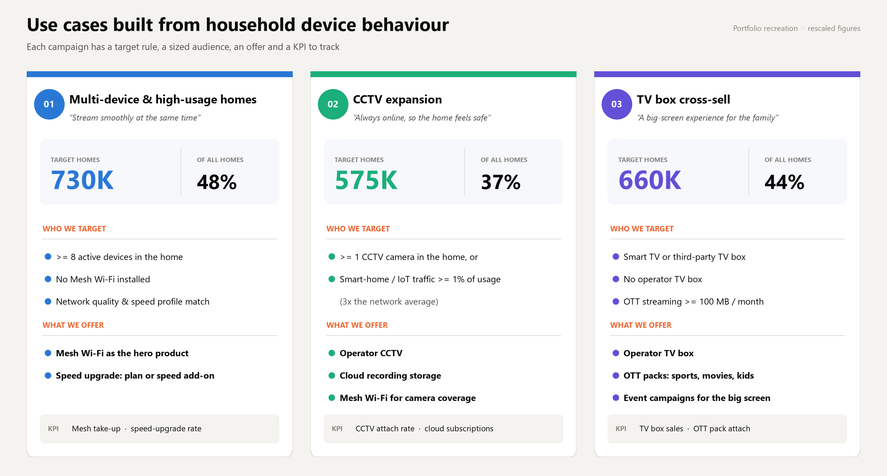
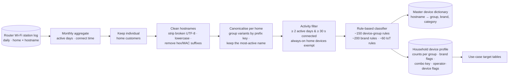
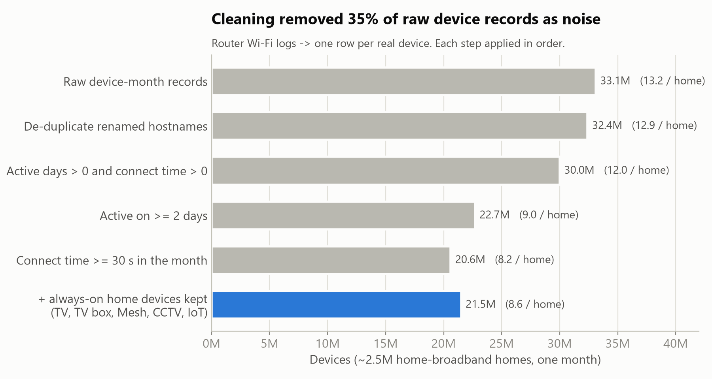
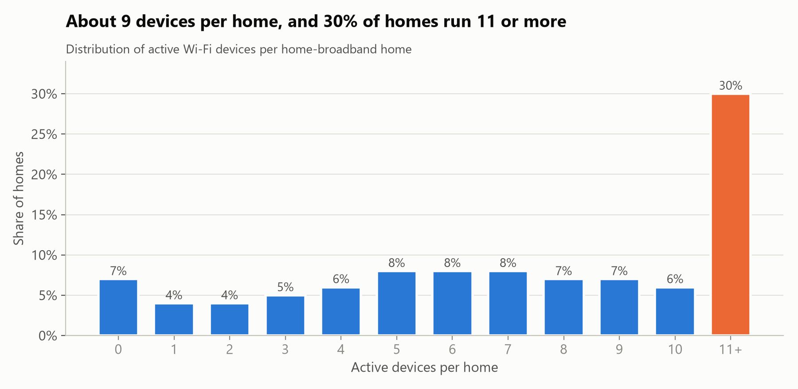
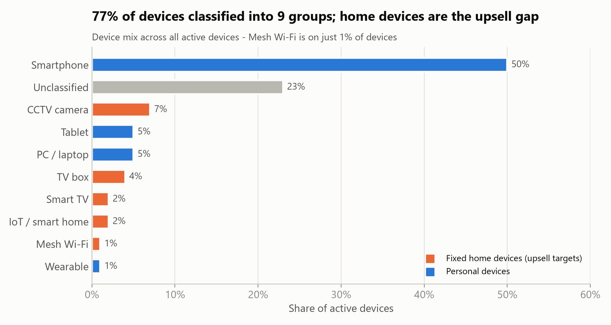
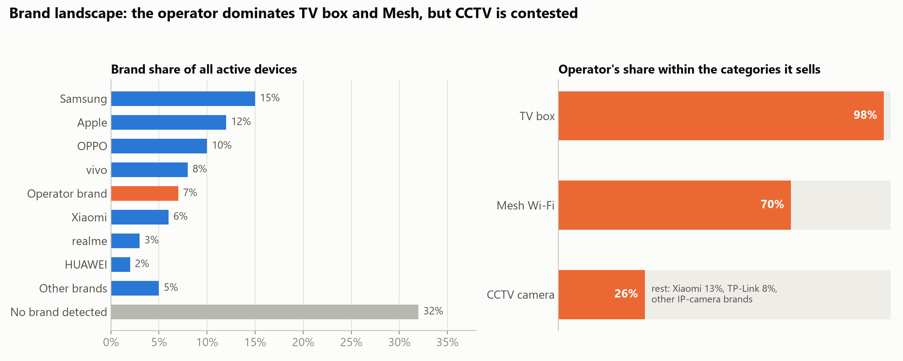
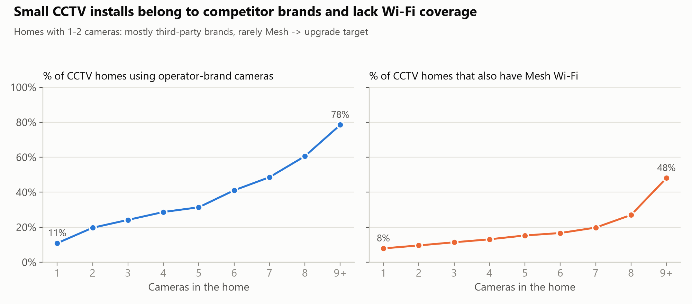
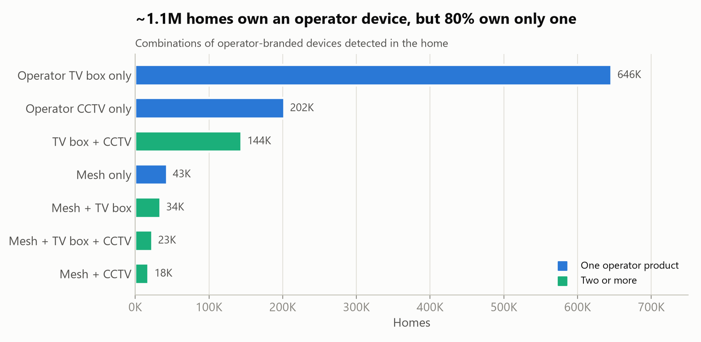

# Household Device Analytics & Upsell Use-Case Design

**Home Broadband · Customer Value Management · Thai telecom operator · 2025**

> **About the numbers.** This is real work done on production data. To protect confidential information, all figures are **rescaled**: counts are scaled, shares are slightly perturbed, and usage is shown as an index. Operator brand and product names are anonymised. **The patterns, rankings and conclusions are the same as in the original analysis.**

Until this project, home-broadband campaigns were targeted only on customer profile and basic usage. The business could not see **what is actually inside each home**: how many devices, which kinds, which brands, and whether they already own the operator's Mesh Wi-Fi, CCTV or TV box.

I turned raw router Wi-Fi logs into a **household-level device profile** for **~2.5M home-broadband customers**. I then analysed device and brand combinations to find upsell gaps, and turned the findings into **three targeted selling use cases covering 575K–730K homes each**.



---

## Highlights

| | |
|---|---|
| **Scale** | ~2.5M homes · ~33M raw device records per month → ~21.5M real devices |
| **Classifier** | ~400 SQL regex rules map free-text Wi-Fi hostnames to **9 device groups, brand and IoT category**; 77% of devices classified, 68% branded |
| **Insight** | About **9 devices per home**, and 30% of homes have 11+. Yet **Mesh Wi-Fi sits in only ~6% of homes**, and 80% of homes with an operator device own just one operator product |
| **Output** | 3 use cases with target logic, sizing and offers, plus a reusable device dataset for campaign targeting |

---

## 1. From router logs to real devices (data engineering)

The router reports every device that joins the home Wi-Fi with a **hostname**, a free-text name chosen by the device or its owner, for example `Galaxy-S23`, `iPhone`, `nomi-ipc-a22e-g-v2`, `roborock-vacuum-a104` or `DESKTOP-XXXX`. These names are noisy:
- the same device appears under several names (OS updates, randomised suffixes)
- many records are short visits (guests, neighbours, one-off connections)
- there is no field for "device type" or "brand"



**Cleaning impact.** 35% of raw records were noise, and devices per home fell from ~13 to ~9:



**Design decisions worth noting**
- **Survivorship-aware de-duplication.** Name variants of one device are grouped by a normalised prefix key. Within each group, the canonical name is the one that passes the activity filter, then has the most active days and connect time. So a renamed phone counts once, not twice.
- **Domain-aware filtering.** Phones and laptops must be active on at least 2 days with meaningful connect time. Always-on home devices (TV, TV box, Mesh, CCTV, IoT) are exempt, because a camera that connects once and stays connected is real.
- **Ordered rule engine.** Specific overrides run first (exact model codes such as `rmx2189` → realme phone, `c530ws` → camera), then brand and feature patterns, then generic catch-alls. Rules were added iteratively by reviewing the largest "Other" hostnames.
- **Reusable outputs.** A hostname → (group, brand, category) **dictionary table** can be reused as a lookup. A wide **household profile table** (device counts per group, per-brand counts, IoT categories, combination keys, operator-device flags) feeds campaign targeting directly.

### Post-validation (after the build)

[`sql/dq_checks.sql`](sql/dq_checks.sql) runs after the build and returns PASS / FAIL per check, plus an *OK TO PUBLISH / HOLD* summary:

| Group | Checks |
|---|---|
| **Source → target** | Homes ≤ individual circuits in the product dimension; share of raw device records kept after cleaning within 50–80% (baseline ~65%); ≥ 80% of homes in the raw log keep at least one device |
| **Keys** | One row per home per month; one classification per hostname in the dictionary |
| **Classification** | ≥ 75% of devices classified; ≤ 1% NULL hostnames (a jump means the router feed stopped sending names) |
| **Drift vs the previous run** | Homes ±5%, devices per home ±10%, smartphone share ±3pp — catches a feed change or a rule that suddenly moved a large group |

➡️ Details and rule examples: [docs/device_classification.md](docs/device_classification.md) · SQL: [sql/household_device_classification.sql](sql/household_device_classification.sql)

---

## 2. What is inside the home (analysis)

### Homes are heavily multi-device



### Personal devices dominate; the operator's home products are a small slice



### Brand landscape



- **Across all devices**, Samsung (15%), Apple (12%), OPPO (10%) and vivo (8%) lead. Operator-branded devices make up 7%.
- **TV boxes:** the operator holds **98%** of detected TV boxes. **Mesh:** it holds **70%**. Where the operator sells the product, it dominates.
- **CCTV is contested.** The operator has only **26%** of cameras. Xiaomi (13%), TP-Link (8%) and other IP-camera brands share the rest.

### CCTV: small installs are the upgrade gap



Operator cameras win large installs (~79% of homes with 9+ cameras), but only ~11% of single-camera homes. Mesh ownership also rises with camera count. Homes with many cameras need Wi-Fi coverage, which makes them a natural bundle.

### The operator's own devices: wide reach, little cross-holding



### Common device combinations (top household "fingerprints")

| Combination | Homes | Share |
|---|---|---|
| Smartphone only | ~284K | 12% |
| Smartphone + CCTV | ~194K | 8% |
| Smartphone + TV / TV box | ~191K | 8% |
| Smartphone + TV / TV box + CCTV | ~168K | 7% |
| Smartphone + PC | ~97K | 4% |
| Smartphone + Tablet | ~92K | 4% |

70% of homes have devices from 2–4 different groups. Only **9% of the ~1.05M homes with CCTV also have Mesh Wi-Fi**.

---

## 3. Use cases

Each use case combines the device profile with usage signals from the team's companion app-usage dataset, then is sized on the matched base. Usage is indexed so that the average home = 100.

| # | Use case | Target logic | Homes | Usage index | Offer |
|---|---|---|---|---|---|
| 1 | **Multi-device & high-usage** | ≥ 8 active devices **and** no Mesh Wi-Fi (checked against network quality and speed profile) | **~730K** (48%) | **124** | Mesh Wi-Fi as hero product + speed upgrade (main-package upsell or speed add-on) |
| 2 | **CCTV expansion** | ≥ 1 camera **or** smart-home/IoT traffic ≥ 1% of usage (3× average) | **~575K** (37%) | 108 | Operator CCTV, cloud recording storage, Mesh Wi-Fi |
| 3 | **TV box cross-sell** | Smart TV or third-party TV box, **no** operator TV box, **and** OTT streaming ≥ 100 MB | **~660K** (44%) | 104 | Operator TV box + OTT packs (sports, movies, kids) + event campaigns |

**Proposed roll-out**
1. Store the segments as reusable tables in the broadband data mart.
2. Push the target lists into CVM campaign tools (outbound, digital, in-app).
3. A/B test bundles and price points per segment, for example Mesh only vs Mesh + speed, or CCTV only vs CCTV + cloud.
4. Track conversion and revenue uplift, then tune thresholds (for example ≥ 8 vs ≥ 6 devices).

---

## Repository

```
├── README.md
├── docs/
│   ├── device_classification.md   # pipeline & rule-engine detail
│   ├── make_charts.py             # renders all charts (rescaled figures)
│   └── images/
└── sql/
    ├── 00_setup_once.sql                  # one-off: columns the monthly script fills
    ├── household_device_classification.sql
    └── dq_checks.sql                      # post-validation checks per month
```

**Tools:** SQL (Netezza: regex functions, window functions, MPP distribution) · Excel · PowerPoint

**My scope:** the device data pipeline, the device and brand analysis, and the design and sizing of the three use cases. The application-usage dataset (traffic by app category) was built separately by the team.

> *The SQL logic is shared as written in production. Schema, operator brand and product names are anonymised, and device-level identifiers are removed. No customer-level data is included.*
